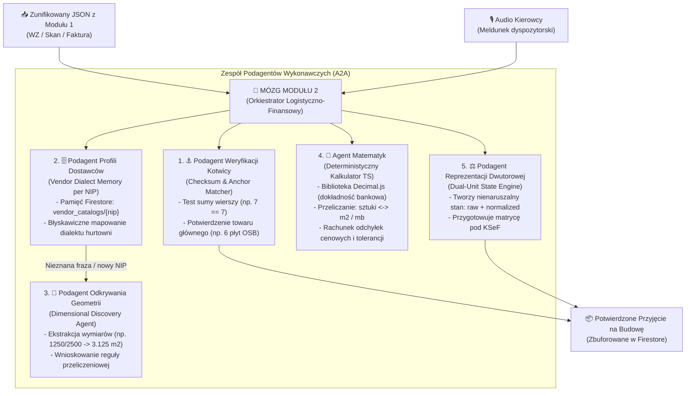
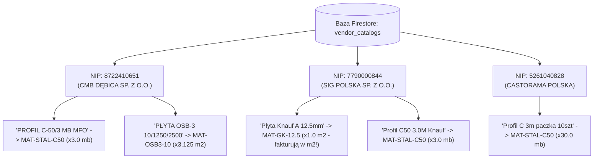
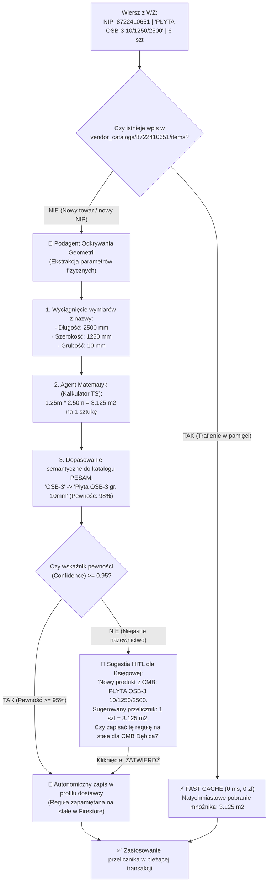
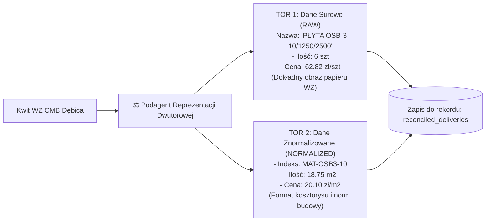
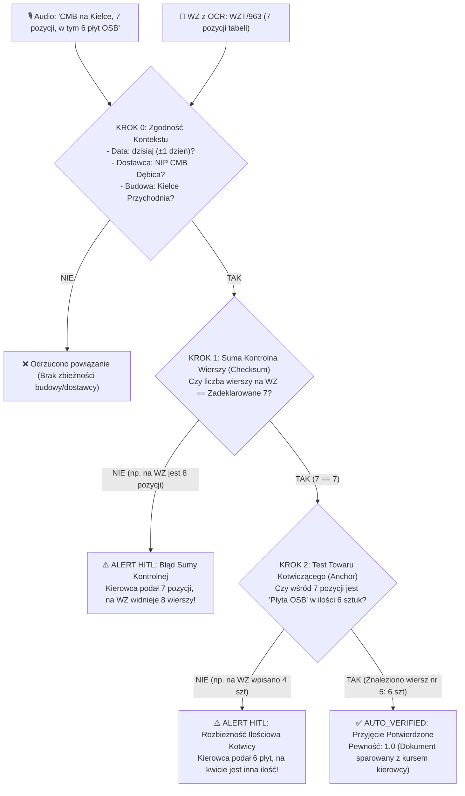
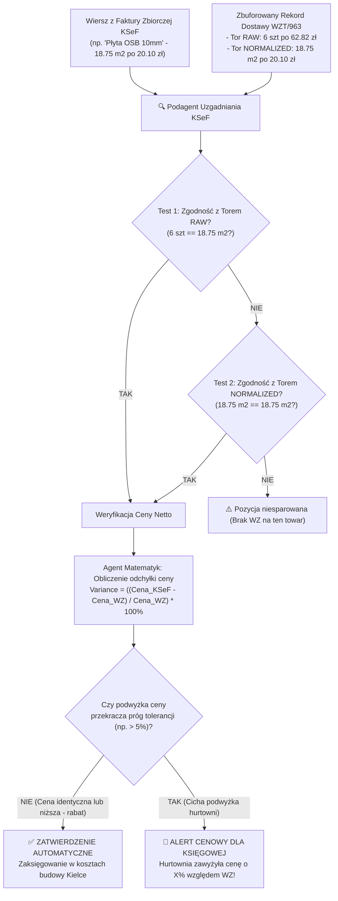

# 📐 DOKUMENTACJA ARCHITEKTONICZNA: MODUŁ 2 (CZĘŚĆ 1/3)
### Mózg Logistyczno-Finansowy, Normalizacja Dwutorowa i Silnik Uzgadniania (Głos $\leftrightarrow$ WZ $\leftrightarrow$ KSeF)

---

## 1. Misja i Rola Modułu 2 w Ekosystemie PESAM 3.0

Moduł 2 stanowi **analityczno-decyzyjny rdzeń** firmy budowlanej. Pobiera surowe, zunifikowane dane z Modułu 1 (cyfrowe WZ, skany z kabin kierowców, notatki audio dyktowane w pośpiechu, pliki XML z KSeF) i przekształca je w twarde, bezbłędne zdarzenia magazynowo-księgowe.

Głównym zadaniem modułu jest **zlikwidowanie luki między placem budowy a księgowością**:
* Przekłada żargon kierowców i specyficzne nazwy hurtowni na jednolity katalog materiałowy PESAM.
* Prowadzi **reprezentację dwutorową (Dual-Unit)**, zabezpieczając system przed rozbieżnościami na comiesięcznych fakturach zbiorczych z KSeF.
* Weryfikuje fizyczny odbiór towaru przez kierowcę za pomocą matematycznej sumy kontrolnej.
* Pilnuje marży i budżetów kontraktów, wychwytując każdą nieuzgodnioną podwyżkę cen powyżej zdefiniowanego progu tolerancji (np. $>5\%$).

---

## 2. Pięć Problemów Budowlanych, które Moduł 2 Rozwiązuje

1. **Wieża Babel jednostek miar (Unit Mismatch):**  
   Hurtownia sprzedaje profile w sztukach ($27\text{ szt.}$), kierowca melduje *„profile”*, a kosztorys budowy i inżynier rozliczają podwykonawcę w **metrach bieżących ($81\text{ mb}$)**. To samo dotyczy płyt (sztuki $\leftrightarrow m^2$) oraz chemii budowlanej (wiadra/worki $\leftrightarrow \text{kg}$).
2. **Pułapka comiesięcznej faktury zbiorczej KSeF:**  
   Jeśli system nadpisze jednostki z WZ na $m^2$, a pod koniec miesiąca hurtownia wystawi fakturę w KSeF w sztukach (lub odwrotnie), tradycyjny automat zgłosi fałszywy błąd. Moduł 2 zachowuje **oba stany równolegle**.
3. **Lokalne dialekty ERP dostawców (per NIP):**  
   Każdy dostawca w Polsce inaczej koduje ten sam produkt. System nie może być „ogólnym słownikiem” – musi posiadać dedykowaną pamięć zachowań przypisaną do konkretnego NIP-u dostawcy.
4. **Halucynacje arytmetyczne modeli AI:**  
   Modele LLM generują tekst statystycznie i gubią grosze przy zaokrągleniach lub skomplikowanym dzieleniu. W KSeF błąd o 1 grosz skutkuje odrzuceniem deklaracji podatkowej.
5. **Realizm pracy kierowcy na placu budowy:**  
   Żaden kierowca nie przeczyta do dyktafonu 20 linijek drobnicy (wkrętów, kołków, taśm). Wymuszenie długich nagrań kończy się buntem pracowników i brakiem wpisów.

---

## 3. Żelazna Reguła Inżynieryjna: Rozdział Semantyki od Arytmetyki

Moduł 2 wprowadza bezwzględną zasadę podziału odpowiedzialności:

$$\text{Zadanie} = \underbrace{\text{Zrozumienie tekstu, intencji i wymiarów (Model AI)}}_{\text{SEMANTYKA}} \;+\; \underbrace{\text{Mnożenie, dzielenie, sumy, grosze, procenty (Kod TS)}}_{\text{ARYTMETYKA DETERMINISTYCZNA}}$$

* **Model LLM:** Wykrywa encje, odczytuje parametry z pogniecionych kartek lub głosu (np. *„szerokość 1250, długość 2500, sztuk 6”*), rozpoznaje slang (*„regipsy” $\rightarrow$ płyta G-K*).
* **Agent Matematyk (TypeScript + Decimal.js):** Wykonuje równania, przelicza metry kwadratowe i bieżące, oblicza odchyłki cenowe, sprawdza sumy pozycji. Modelowi AI **nie wolno wykonać ani jednego działania arytmetycznego w pamięci**.

---

## 4. Architektura Wieloagentowa (A2A) Modułu 2

Strukturą wykonawczą modułu jest **Mózg Orkiestrujący** kierujący zespołem 5 wyspecjalizowanych podagentów:



### Role i Odpowiedzialności Podagentów:

1. **Orkiestrator Modułu 2 (Mózg Logistyczny):**  
   Zarządza sekwencją wywołań. Nie podejmuje decyzji „na oko” – zbiera raporty od podagentów i generuje stan końcowy transakcji.
2. **Podagent Weryfikacji Kotwicy (`VoiceAnchorMatcher`):**  
   Odbiera meldunek kierowcy i natychmiast zderza go z liczbą pozycji na WZ oraz z towarem kluczowym. Odsiewa próby oszustw i pomyłki magazynowe.
3. **Podagent Profili Dostawców (`VendorMemoryAgent`):**  
   Wyszukuje pozycję w lokalnej bazie danego NIP-u dostawcy. Jeśli hurtownia CMB Dębica nazywa profil `PROFIL C-50/3 MB MFO`, ten agent w $2\text{ ms}$ zamienia to na standard PESAM za **0 zł kosztu API**.
4. **Podagent Odkrywania Geometrii (`DimensionalDiscoveryAgent`):**  
   Wzywany tylko wtedy, gdy `VendorMemoryAgent` nie znajdzie frazy w bazie. Analizuje ciąg tekstowy pod kątem wymiarów geometrycznych (np. $1250 \times 2500\text{ mm}$, $3\text{ MB}$, $\text{OPAK.50SZT}$) i proponuje nowy wzorzec przeliczeniowy.
5. **Agent Matematyk (`DeterministicMathEngine`):**  
   Jedyny komponent uprawniony do wykonywania obliczeń. Zapewnia dokładność co do 1 grosza i 4 miejsc po przecinku w przelicznikach jednostek.
6. **Podagent Reprezentacji Dwutorowej (`DualUnitEngine`):**  
   Gwarantuje, że do bazy trafia rekord zawierający jednocześnie dane surowe z papieru (`raw`) oraz dane znormalizowane dla inżynierów (`normalized`).

---

# 📐 DOKUMENTACJA ARCHITEKTONICZNA: MODUŁ 2 (CZĘŚĆ 2/3)
### Profile Dostawców per NIP, Pętla Samouczenia i Reprezentacja Dwutorowa (Dual-Unit)

---

## 1. Katalog Dialektów Dostawców per NIP (`vendor_catalogs`)

W polskim handlu materiałami budowlanymi nie istnieje centralny słownik indeksów. Każda hurtownia nadaje własne nazwy handlowe i stosuje własne jednostki bazowe w swoim systemie ERP (Comarch Optima, Subiekt GT, SAP, Enova).

Dlatego w Firestore struktura bazy nie jest jednym płaskim słownikiem, lecz posiada podział hierarchiczny, gdzie **twardą kotwicą jest NIP Sprzedawcy**:

$$\text{Ścieżka Firestore: } \mathbf{vendor\_catalogs/\{vendor\_nip\}/items/\{item\_hash\}}$$



### Schemat Dokumentu Pozycji Dostawcy w Firestore (`vendor_catalogs/{nip}/items/{item_hash}`)

Klucz dokumentu (`item_hash`) to skrót SHA-256 z oczyszczonej nazwy surowej (`clean_raw_name`), co zapewnia natychmiastowe wyszukiwanie w czasie $O(1)$:

```typescript
// src/types/biuro/vendorCatalog.types.ts

export interface VendorCatalogItem {
  vendor_nip: string;                 // np. "8722410651"
  vendor_raw_name: string;            // np. "PROFIL C-50/3 MB MFO /10/200/"
  clean_lookup_key: string;           // np. "PROFIL_C_50_3_MB_MFO" (oczyszczone ze znaków specjalnych)
  vendor_invoiced_unit: string;       // np. "szt" (jednostka, w której ta hurtownia zwykła fakturować)

  // Powiązanie z Kanonem PESAM
  canonical_product_id: string;       // np. "MAT-STAL-C50"
  canonical_name: string;             // np. "Profil stalowy ścienny C-50"
  pesam_accounting_unit: 'm2' | 'mb' | 'szt' | 'kg' | 'kpl'; // Standard kosztorysowy PESAM

  // Twarda reguła konwersji jednostek
  conversion_rule: {
    multiplier: number;               // np. 3.0 (dla 3 metrów bieżących z 1 sztuki)
    formula: string;                  // np. "1 szt = 3.0 mb"
    operation: 'MULTIPLY' | 'DIVIDE' | 'STATIC';
  };

  // Metadane zaufania i pętli samouczenia
  confidence_score: number;           // 0.0 do 1.0 (1.0 = zatwierdzony przez człowieka)
  learned_source: 'AUTO_GEOMETRY_DISCOVERY' | 'HUMAN_VERIFIED' | 'HISTORICAL_IMPORT';
  usage_count: number;                // Ile razy z powodzeniem użyto tej reguły
  last_used_at: string;               // ISO Timestamp
}
```

---

## 2. Pętla Samouczenia: Wykrywanie Nowego Dostawcy i Produktu

Gdy do Modułu 2 trafia dokument z pozycją, której nie ma w kolekcji danego NIP-u, system uruchamia autonomiczną pętlę uczenia się. 

Pętla łączy zdolności analizy tekstu przez LLM z deterministyczną weryfikacją geometryczną przez Agenta Matematyka:



### Korzyść biznesowa z pętli samouczenia:
* **Pierwszy dokument od nowego kontrahenta:** Analiza trwa ok. $300\text{ ms}$, zużywając pojedyncze zapytanie do modelu wizyjnego/tekstowego.
* **Kolejne 1000 dokumentów od tego kontrahenta:** Moduł pomija model AI. Odczytuje gotowy przelicznik z Firestore w $2\text{ ms}$ przy **koszcie 0 zł**.

---

## 3. Reprezentacja Dwutorowa (Dual-Unit Recording)

Złota zasada inżynierii danych w PESAM 3.0 brzmi: **żadne dane z oryginalnego dokumentu nie mogą zostać utracone ani zastąpione**.

W bazie danych transakcja przyjęcia towaru na budowę otrzymuje dwa równoległe wymiary danych (`raw` oraz `normalized`):



### Realny przykład: Pozycje z dokumentu `WZT/963` po przejściu przez Tor Dwutorowy

Poniżej znajduje się zestawienie, jak Agent Matematyk i Podagent Dwutorowy przekształcają kluczowe pozycje z zapisanego wcześniej pliku `wzt_963_sample.json`:

| Lp | Dane Surowe z Papieru (`raw`) | Reguła Przeliczenia z Profilu NIP | Dane Znormalizowane PESAM (`normalized`) |
|:---:|---|---|---|
| **1** | `PROFIL C-50/3 MB MFO /10/200/`<br>**27.00 szt** $\times 9.87\text{ zł}$ = $266.49\text{ zł}$ | Wymiar `3 MB` $\rightarrow$ mnożnik $\times 3.0$ | `Profil stalowy ścienny C-50`<br>**81.00 mb** $\times 3.29\text{ zł}$ = $266.49\text{ zł}$ |
| **2** | `PROFIL U- 50/3MB MFO /10/200/ W.`<br>**14.00 szt** $\times 7.06\text{ zł}$ = $98.84\text{ zł}$ | Wymiar `3 MB` $\rightarrow$ mnożnik $\times 3.0$ | `Profil stalowy obwodowy U-50`<br>**42.00 mb** $\times 2.35\text{ zł}$ = $98.84\text{ zł}$ |
| **3** | `KLIMAS WKRĘTY ... TEX A 200`<br>**2.00 opak** $\times 9.61\text{ zł}$ = $19.22\text{ zł}$ | Oznaczenie paczki `200` $\rightarrow$ mnożnik $\times 200.0$ | `Wkręty samowiercące TEX 3.5x9.5`<br>**400.00 szt** $\times 0.048\text{ zł}$ = $19.22\text{ zł}$ |
| **5** | `PŁYTA OSB-3 10/1250/2500`<br>**6.00 szt** $\times 62.82\text{ zł}$ = $376.92\text{ zł}$ | Wymiary $1.25 \times 2.50\text{ m} \rightarrow$ mnożnik $\times 3.125$ | `Płyta OSB-3 grubość 10 mm`<br>**18.75 m²** $\times 20.10\text{ zł}$ = $376.92\text{ zł}$ |
| **7** | `KLIMAS KOŁKI ... OPAK.50SZT`<br>**2.00 opak** $\times 5.22\text{ zł}$ = $10.44\text{ zł}$ | Oznaczenie paczki `50SZT` $\rightarrow$ mnożnik $\times 50.0$ | `Kołki do wbijania SM 6x40`<br>**100.00 szt** $\times 0.104\text{ zł}$ = $10.44\text{ zł}$ |

---

## 4. Dlaczego Reprezentacja Dwutorowa jest Tarczą Ochronną?

Gdy na koniec miesiąca hurtownia CMB Dębica wystawi fakturę zbiorczą w KSeF obejmującą dostawę `WZT/963`, księgowość CMB może wybrać jeden z dwóch wariantów fakturowania:

* **Wariant A (Faktura wystawiona w sztukach):**  
  Na fakturze KSeF widnieje: `PŁYTA OSB-3 10/1250/2500 - 6 szt. po 62.82 zł`.  
  $\rightarrow$ System PESAM testuje **Tor 1 (RAW)**: zgodność ilościowa ($6 = 6$) i cenowa ($62.82 = 62.82$).  
  **Wynik: ZGODNE.**
* **Wariant B (Faktura wystawiona w $m^2$):**  
  Na fakturze KSeF widnieje: `Płyta OSB 10mm - 18.75 m² po 20.10 zł`.  
  $\rightarrow$ System PESAM testuje **Tor 2 (NORMALIZED)**: zgodność ilościowa ($18.75 = 18.75$) i cenowa ($20.10 = 20.10$).  
  **Wynik: ZGODNE.**

W obu przypadkach proces rozliczenia faktury KSeF przechodzi w **100% automatycznie**, eliminując konieczność ręcznego dochodzenia przez księgową, dlaczego na magazynie były sztuki, a na fakturze są metry kwadratowe.

---

# 📐 DOKUMENTACJA ARCHITEKTONICZNA: MODUŁ 2 (CZĘŚĆ 3/3)
### Weryfikacja Głosu (Checksum & Anchor), Parowanie KSeF, Polityka Progowa i Panel HITL

---

## 1. Silnik Weryfikacji Głosu Kierowcy: Wzorzec Sumy Kontrolnej i Kotwicy

Kierowca nie ma czasu na drobiazgowe dyktowanie kilkunastu pozycji. Wprowadzamy w firmie 4-sekundową procedurę meldunku (SOP):

$$\text{Meldunek Kierowcy} = \mathbf{[Dostawca]} \rightarrow \mathbf{[Budowa]} \rightarrow \mathbf{[Liczba\;pozycji\;z\;kwitu]} \rightarrow \mathbf{[Jeden\;główny\;towar\;+\;ilość]}$$

> *„CMB na Kielce, 7 pozycji na kwicie, w tym 6 płyt OSB.”*

### Algorytm Dwuetapowej Weryfikacji (Podagent `VoiceAnchorMatcher`)

Gdy notatka audio trafia do systemu, Podagent Weryfikacji Kotwicy przeprowadza test kryptograficzno-kontrolny w dwóch krokach:



---

## 2. Silnik Uzgadniania Faktur Zbiorczych KSeF (`KSeFReconciler`)

Pod koniec miesiąca z KSeF pobierana jest faktura centralna XML (format FA_VAT), która potrafi zawierać kilkadziesiąt pozycji z różnych budów.

Dzięki **reprezentacji dwutorowej** Podagent Uzgadniania KSeF nie musi zgadywać – wykonuje test dopasowania w oparciu o alternatywę logiczną:

$$\text{Dopasowanie Wiersza} = \mathbf{Match}\left(\text{KSeF}, \text{Tor}_{\text{RAW}}\right) \lor \mathbf{Match}\left(\text{KSeF}, \text{Tor}_{\text{NORMALIZED}}\right)$$



---

## 3. Konfiguracja Polityki Zgodności w Firestore (`settings/biuro_matching_policy`)

System nie ma sztywno zaszytych reguł w kodzie. Wszelkie progi tolerancji są definiowane w panelu administracyjnym `/dashboard/biuro` i przechowywane w dokumencie konfiguracyjnym:

```typescript
// src/types/biuro/matchingPolicy.types.ts

export interface BiuroMatchingPolicy {
  // Progi dla Weryfikacji Głosu Kierowcy
  voice_rules: {
    require_checksum_match: boolean;      // Czy liczba wierszy musi się zgadzać w 100% (domyślnie: true)
    require_anchor_match: boolean;        // Czy towar kotwiczący musi wystąpić na WZ (domyślnie: true)
    allow_partial_item_coverage: boolean; // Czy zezwalać na brak wymienienia drobnicy montażowej
    low_value_item_threshold_pln: number; // np. 30.00 PLN (pozycje poniżej tej kwoty traktowane jako drobnica)
  };

  // Progi dla Parowania z Fakturą KSeF
  ksef_reconciliation_rules: {
    max_price_variance_pct: number;       // np. 5.0 (odchyłka ceny do +5% przechodzi, powyżej -> blokada)
    auto_approve_discounts: boolean;      // Jeśli hurtownia dała niższą cenę niż na WZ -> zawsze auto-akceptacja
    date_window_tolerance_days: number;   // np. 35 dni (maksymalny rozstęp między datą WZ a fakturą KSeF)
  };

  // Uprawnienia do zatwierdzania HITL
  approvals: {
    require_director_above_pln: number;   // np. 5000.00 PLN (odchyłki powyżej tej kwoty wymagają akceptacji Zarządu)
  };
}
```

---

## 4. Architektura Panelu Human-in-the-Loop (HITL)

Gdy automat napotka anomalię, proces nie ulega zawieszeniu. Dokument trafia do kolejki weryfikacyjnej w panelu `/dashboard/biuro/uzgadnianie`.

Interfejs użytkownika zaprojektowano z myślą o minimalizacji wysiłku – księgowa lub kierownik budowy podejmują decyzję **jednym kliknięciem myszy**:

```
+---------------------------------------------------------------------------------------------------------+
| ⚠️ WYKRYTO ROZBIEŻNOŚĆ W KSEF: Hurtownia CMB Dębica | Budowa: KIELCE PRZYCHODNIA                         |
+---------------------------------------------------------------------------------------------------------+
| Pozycja: PŁYTA OSB-3 10/1250/2500                                                                       |
|                                                                                                         |
|   WZ Papierowa (kierowca):    6.00 szt.  @ 62.82 zł/szt. (18.75 m² @ 20.10 zł/m²)   Łącznie: 376.92 zł    |
|   Faktura KSeF (zbiorcza):    18.75 m²   @ 21.80 zł/m²                              Łącznie: 408.75 zł    |
|                                                                                                         |
|   WYNIK AUDYTU: Wykryto podwyżkę ceny o +8.46% (+31.83 zł netto). Przekroczono limit tolerancji (5.0%). |
+---------------------------------------------------------------------------------------------------------+
| [ AKCEPTUJ PODWYŻKĘ (Zmień budżet) ]    [ WYSTĄP O KOREKTĘ DO CMB ]    [ REKLAMACJA: PRZEŚLIJ DO SZEFA ] |
+---------------------------------------------------------------------------------------------------------+
```

---

## 5. Zunifikowany Kontrakt Wyjściowy Modułu 2 (Gotowy JSON)

Poniższy obiekt JSON stanowi finalny produkt pracy Modułu 2 dla dokumentu `WZT/963`. Ten rekord jest zapisywany w kolekcji `reconciled_deliveries` i staje się nienaruszalną podstawą rozliczeń dla kolejnych modułów:

```json
{
  "reconciliation_id": "REC-20261124-WZT963-001",
  "metadata": {
    "created_at": "2026-11-24T10:15:00Z",
    "status": "AUTO_RECONCILED",
    "confidence_score": 1.0,
    "source_wz_id": "ING-20261124-WZT963"
  },
  "parties": {
    "vendor": {
      "nip": "8722410651",
      "name": "PRZEDSIĘBIORSTWO HANDLOWO USŁUGOWE CMB DĘBICA SP. Z O.O."
    },
    "buyer": {
      "nip": "8720004013",
      "name": "PESAM SPÓŁKA Z O.O. SP. K."
    },
    "target_site": "KIELCE PRZYCHODNIA"
  },
  "driver_audit": {
    "verification_method": "CHECKSUM_AND_ANCHOR",
    "is_physically_confirmed": true,
    "declared_line_count": 7,
    "actual_line_count": 7,
    "anchor_item": "PŁYTA OSB-3",
    "anchor_quantity_matched": true,
    "driver_audio_ref": "audio/2026-11-18/kielce_dawid_0939.mp3"
  },
  "items": [
    {
      "lp": 1,
      "canonical_id": "MAT-STAL-C50",
      "raw": {
        "name": "PROFIL C-50/3 MB MFO /10/200/",
        "quantity": 27.0,
        "unit": "szt",
        "unit_price_net": 9.87,
        "total_net": 266.49
      },
      "normalized": {
        "standard_name": "Profil stalowy ścienny C-50",
        "quantity": 81.0,
        "unit": "mb",
        "unit_price_net": 3.29,
        "total_net": 266.49
      },
      "conversion": {
        "multiplier": 3.0,
        "formula": "1 szt = 3 mb",
        "source": "VENDOR_PROFILE_CACHE"
      }
    },
    {
      "lp": 5,
      "canonical_id": "MAT-DREW-OSB3-10MM",
      "raw": {
        "name": "PŁYTA OSB-3 10/1250/2500",
        "quantity": 6.0,
        "unit": "szt",
        "unit_price_net": 62.82,
        "total_net": 376.92
      },
      "normalized": {
        "standard_name": "Płyta drewnopochodna OSB-3 gr. 10 mm",
        "quantity": 18.75,
        "unit": "m2",
        "unit_price_net": 20.10,
        "total_net": 376.92
      },
      "conversion": {
        "multiplier": 3.125,
        "formula": "1.25m * 2.50m = 3.125 m2/szt",
        "source": "VENDOR_PROFILE_CACHE"
      }
    }
  ],
  "financial_summary": {
    "total_net_wz": 790.58,
    "total_vat_wz": 181.83,
    "total_gross_wz": 972.41,
    "ksef_matched_invoice_no": "FA/2026/11/8832",
    "ksef_price_variance_pct": 0.0,
    "budget_status": "CHARGED_TO_SITE_KIELCE"
  }
}
```

---

## Podsumowanie Całości Modułu 2

Zaprojektowany Moduł 2 tworzy **spójny, autonomiczny system**:
1. **Dla kierowcy:** 4 sekundy meldunku przez dyktafon (suma kontrolna + kotwica).
2. **Dla hurtowni:** Każdy NIP ma swój zapamiętany dialekt i reguły przeliczania.
3. **Dla inżyniera budowy:** Kosztorys otrzymuje precyzyjne jednostki ($m^2$, $mb$).
4. **Dla księgowości:** Faktura zbiorcza z KSeF paruje się w 100% automatycznie dwoma torami, a ciche podwyżki cen powyżej 5% są natychmiast blokowane.
5. **Dla budżetu firmy:** Zero błędów zaokrągleń (dzięki Agentowi Matematykowi) i zero zbędnych kosztów API (dzięki pamięci profili).