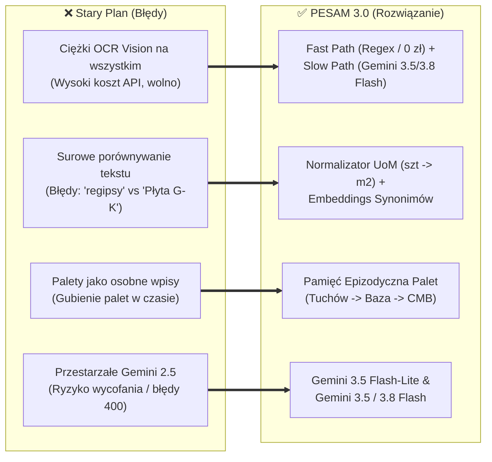
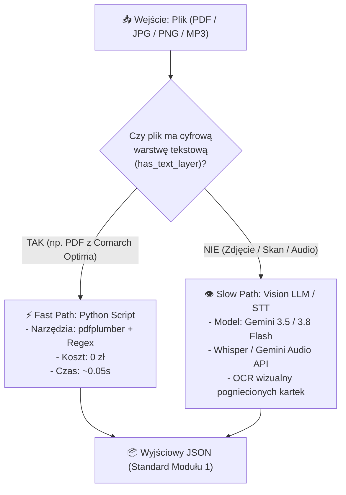
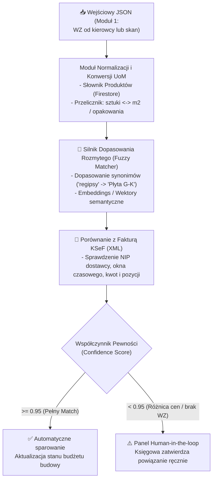
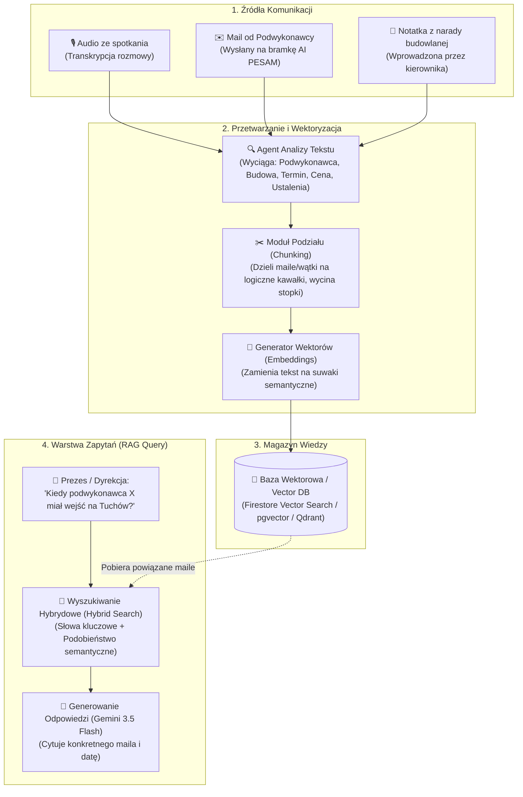
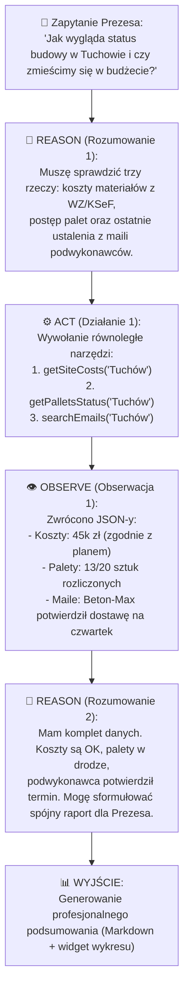

# 📐 Dokument Architektoniczny: PESAM 3.0 (BIURO AI)
### System Inteligentnego Przetwarzania Dokumentów, Normalizacji i Komunikacji Budowlanej

**Wersja:** 3.0 (Produkcyjna)  
**Data:** Listopad 2026  
**Autor:** Główny Architekt Systemu PESAM & Zespół R&D  
**Status:** Zatwierdzony do wdrożenia  
**Powiązany moduł aplikacji:** `/dashboard/biuro`  

---

## 1. Wprowadzenie i Nowy Paradygmat Architektoniczny

PESAM 3.0 to kompletna ewolucja systemu zaplecza biurowo-magazynowego firmy budowlanej. Zastępuje dotychczasowy, pasywny model gromadzenia danych w pełni autonomicznym, ekonomicznym i samouczącym się ekosystemem agentowym.

Nowa architektura opiera się na **czterech wyspecjalizowanych modułach**:
1. **Moduł 1 (Smart Router & Fast/Slow Path):** Błyskawiczna ingestja dokumentów z minimalizacją kosztów LLM do 0 zł dla cyfrowych faktur ERP.
2. **Moduł 2 (Normalizator UoM & Fuzzy Matcher):** Translacja żargonu budowlanego kierowców, przeliczanie jednostek handlowych i bezbłędne parowanie z KSeF.
3. **Moduł 3 (Poczta Podwykonawców & Grounded RAG):** Eliminacja sporów z podwykonawcami dzięki wektorowej pamięci korespondencji i ustaleń.
4. **Moduł 4 (Agenci Autonomiczni & Pętla ReAct):** Samodzielne audyty piątkowe, generowanie raportów dyrektorskich i wczesne wykrywanie anomalii.

---

## 2. Podsumowanie Zmian: Stary Plan vs PESAM 3.0



---

## 3. MODUŁ 1: Ingestja Dokumentów, Smart Router & Fast/Slow Path OCR

Moduł 1 stanowi pierwszą linię obrony i „bramę wejściową” dla wszystkich dokumentów (PDF-y z poczty, skany WZ-tek, zdjęcia z kabiny kierowcy, notatki audio dyktowane na budowie).

### 3.1. Cel Biznesowy
* Przyjęcie dowolnego formatu wejściowego (PDF cyfrowy, skan, zdjęcie JPG/PNG, notatka głosowa audio).
* Rozpoznanie typu dokumentu i natychmiastowe uruchomienie najtańszej i najszybszej ścieżki.
* Wygenerowanie jednolitego, ustrukturyzowanego kontraktu danych (JSON) bez względu na źródło.

### 3.2. Diagram Przepływu Danych (Moduł 1)



### 3.3. Stack Technologiczny
* **Backend:** Next.js API Routes (TypeScript) / Mikroserwis Python (FastAPI).
* **Parser cyfrowy:** `pdfplumber` (Python) lub `@pdf-lib` / `pdfjs-dist` (Node.js).
* **Model wizyjny (Slow Path):** `@google/genai` – model `gemini-3.5-flash` lub `gemini-3.8-flash` z parametrem `responseMimeType: "application/json"`.
* **Moduł mowy (Audio):** Whisper / Gemini Audio API.

### 3.4. Przykładowa Struktura Wyjściowego JSON-a (Standard Modułu 1)
```json
{
  "document_type": "WZ",
  "document_number": "WZT/963/11/2026/DE",
  "issue_date": "2026-11-18",
  "seller": {
    "name": "PRZEDSIĘBIORSTWO HANDLOWO USŁUGOWE CMB DĘBICA SP. Z O.O.",
    "nip": "8722410651"
  },
  "buyer": {
    "name": "PESAM SPÓŁKA Z OGRANICZONĄ ODPOWIEDZIALNOŚCIĄ",
    "nip": "8732804815"
  },
  "target_site_hint": "KIELCE PRZYCHODNIA",
  "items": [
    {
      "lp": 1,
      "name": "PROFIL C-50/3 MB PRO /10/2007/",
      "quantity": 27,
      "unit": "szt",
      "unit_price_net": 9.87,
      "value_net": 266.49,
      "vat_rate": 23
    }
  ],
  "totals": {
    "net": 790.58,
    "vat": 181.83,
    "gross": 972.41
  },
  "processing_meta": {
    "path_used": "fast_path_regex",
    "execution_time_sec": 0.048,
    "model_cost_pln": 0.00,
    "validation_ok": true
  }
}
```

### 3.5. Zabezpieczenia (Edge Cases)
* **Uszkodzony PDF z ERP:** Gdy skrypt Regex napotka błąd lub walidacja matematyczna (`suma_pozycji != suma_ogólna`) zwróci fałsz, dokument jest automatycznie przekierowywany do **Slow Path** (Gemini Vision) w roli ratunkowej.
* **Szum na budowie w nagraniu audio:** Przed przetworzeniem transkrypcja przechodzi przez krótki filtr czyszczący, usuwający powtórzenia i fonetyczne zniekształcenia maszyn budowlanych.

---

## 4. MODUŁ 2: Normalizacja, Jednostki Miary i Fuzzy Matcher (KSeF vs WZ)

Moduł 2 stanowi „mózg logistyczny” systemu. Odpowiada za translację języka placu budowy na język księgowy oraz automatyczne parowanie dostaw z fakturami centralnymi KSeF.

### 4.1. Cel Biznesowy
* Ujednolicenie slangu kierowców (*„regipsy”*, *„pchełki”*, *„setka podłoga”*) do oficjalnych indeksów handlowych.
* Konwersja jednostek miar ($\text{szt} \leftrightarrow \text{m}^2$, $\text{paczka} \leftrightarrow \text{m}^2$, $\text{sztanga} \leftrightarrow \text{kg}/\text{t}$).
* Parowanie rozbitych WZ-tek z wielopozycyjnymi fakturami zbiorczymi z KSeF pod koniec miesiąca.
* Wychwytywanie anomalii cenowych ($> 5\%$ odchyłki od wyceny/umowy) i natychmiastowe alerty HITL.

### 4.2. Diagram Przepływu Danych (Moduł 2)



### 4.3. Stack Technologiczny i Logika Działania
* **Słownik Produktów (`products_mapping` w Firestore):** Baza powiązań indeksów hurtowni z wewnętrznym katalogiem PESAM wraz z regułami matematycznymi:
  ```json
  { "from_unit": "szt", "to_unit": "m2", "multiplier": 2.50 }
  ```
* **Przestrzenie Wektorowe (Embeddings):** Model Gemini Text-Embedding wykrywający, że *„wkręty do regipsów”* to dokładnie ta sama pozycja co *„Wkręt do płyt G-K 3.5x25”*.
* **Silnik Finansowy (KSeF vs WZ):** Walidator TypeScript porównujący pozycje:
  * Ilości muszą być zgodne po znormalizowaniu UoM.
  * Ceny niższe na fakturze niż na WZ (rabat posprzedażowy) $\rightarrow$ auto-akceptacja.
  * Ceny wyższe o $> 5\%$ $\rightarrow$ wstrzymanie płatności i alert dla księgowej.

### 4.4. Log Transakcyjny Parowania
```json
{
  "reconciliation_id": "REC-2026-1118-001",
  "site_target": "KIELCE PRZYCHODNIA",
  "matched_sources": {
    "driver_voice_note": "Wziąłem wkręty i regipsy na Kielce",
    "wz_document": "WZT/963/11/2026/DE (CMB Dębica)",
    "ksef_invoice": "FA/2026/11/8832 (CMB Dębica)"
  },
  "item_matching_audit": [
    {
      "raw_input_name": "regipsy",
      "canonical_name": "PŁYTA G-K KNAUF A 12.5 MM 1200X2600",
      "matched_ksef_item": "PŁYTA GKB KNAUF 12.5 /1200X2600/",
      "quantity_conversion": "15 szt = 37.5 m² (mnożnik 2.50)",
      "status": "MATCHED_EXACT"
    }
  ],
  "financial_audit": {
    "wz_estimated_net": 790.58,
    "ksef_final_net": 790.58,
    "price_variance_pct": 0.0,
    "action_taken": "AUTO_APPROVED"
  }
}
```

### 4.5. Zabezpieczenia (Edge Cases)
* **Zmiana nazwy materiału w nowej fakturze hurtowni:** Przy wskaźniku pewności ok. 60–80% system generuje jedno kliknięcie dla księgowej: *„Czy zapisać synonim na stałe?”*. Po akceptacji baza uczy się reguły dożywotnio.
* **Faktury zbiorcze KSeF (50 pozycji z 10 budów):** Agent dekomponuje XML faktury na pod-paczki na podstawie numerów WZ w polach referencyjnych i rozdziela koszty równolegle do odpowiednich projektów w Firestore.

---

## 5. MODUŁ 3: Poczta Podwykonawców, Bramka Mailowa & RAG Komunikacyjny

Moduł 3 to „pamięć długoterminowa i dyplomatyczna” firmy PESAM. Chroni przedsiębiorstwo przed stratami finansowymi i sporami sądowymi wynikającymi z niedopowiedzeń z podwykonawcami.

### 5.1. Cel Biznesowy
* Dedykowana bramka mailowa (`podwykonawcy@pesam.pl` lub UDW kierowników), która agreguje całą korespondencję zewnętrzną.
* Wyeliminowanie sytuacji, w której kluczowe ustalenia giną w prywatnych telefonach lub skrzynkach pocztowych.
* Silnik wyszukiwania semantycznego (Grounded RAG), odpowiadający na pytania Zarządu w oparciu o twarde źródła.

### 5.2. Diagram Przepływu Danych (Moduł 3)



### 5.3. Przykład Zapytania RAG w Praktyce
> **Zapytanie Prezesa:**  
> *„Czy podwykonawca Beton-Max potwierdził nam w końcu tę dostawę na czwartek do Tuchowa i za jaką cenę?”*

> **Odpowiedź Agenta RAG:**  
> *„Tak, pan Tomasz z Beton-Max potwierdził dostawę na czwartek (26.11) do godziny 10:00 na budowę w Tuchowie. Cena uzgodniona w mailu z wtorku to 340 zł/m³ (zgodnie z aneksem do umowy).”*  
> 📎 **Źródło:** Wątek mailowy `#4492` z dnia 24.11.2026, nadawca: `t.nowak@betonmax.pl`.

### 5.4. Zabezpieczenia (Edge Cases)
* **Niejasne sformułowania podwykonawców (*„będziemy koło środka tygodnia”*):** Agent klasyfikuje status jako `NIEPEWNE` i generuje dla kierownika szkic odpowiedzi doprecyzowującej (*„Czy środek tygodnia oznacza środę rano?”*).
* **Bezpieczeństwo i uprawnienia (RBAC):** Każdy wpis w bazie wektorowej posiada tag `site_id`. Kierownik budowy ma wgląd wyłącznie w korespondencję swojego kontraktu; Zarząd posiada dostęp globalny.

---

## 6. MODUŁ 4: Agenci Wykonawczy, Pętla ReAct i Automatyzacja Raportów

Moduł 4 to „mięśnie i autonomiczne ręce” ekosystemu PESAM. Przekształca bazy danych w aktywne procesy wykonawcze.

### 6.1. Cel Biznesowy
* Całkowita eliminacja ręcznego generowania zestawień przez kadrę inżynierską.
* Implementacja pętli decyzyjnej **ReAct** (Reason $\rightarrow$ Act $\rightarrow$ Observe $\rightarrow$ Repeat) bez ciężkich frameworków.
* Automatyczne alarmy i cykliczne audyty piątkowe wysyłane do Zarządu.

### 6.2. Diagram Pętli ReAct w Praktyce (Przykład Odpowiedzi na Zapytanie Prezesa)



### 6.3. Stack Technologiczny i Realizacja (Czysty TypeScript)
* **Pętla ReAct bez zbędnego narzutu:** Pętla `while` w Next.js/TypeScript wywołująca SDK `@google/genai` z zarejestrowanymi funkcjami narzędziowymi (Tool Calling).
* **Structured Output (Zod):** Format odpowiedzi końcowej wymuszany schematem `responseSchema`, co gwarantuje poprawność widgetów frontendowych.
* **Cykliczne Zadania w Tle (Cron Serverless):** Google Cloud Scheduler wywołujący endpoint `/api/cron/friday-audit` w każdy piątek o godzinie 15:00.

### 6.4. Zabezpieczenia (Edge Cases)
* **Blokada pętli nieskończonej:** Sztywny limit iteracji `max_steps = 5`. Po przekroczeniu następuje automatyczne przerwanie pętli i eskalacja do administratora.
* **Ochrona przed halucynacjami finansowymi:** Wszelkie sumowania, przeliczenia walutowe i wyliczenia salda palet wykonuje **twardy kod deterministyczny**. Agent wyłącznie interpretuje wyniki i formułuje wnioski.

---

## 7. Model Bezpieczeństwa i Guardrails

1. **Izolacja Danych Wrażliwych:** Żaden model LLM nie ma dostępu do kolekcji `users`, `passwords`, `tokens` ani ról systemowych.
2. **Finansowe Human-in-the-Loop:** Autonomiczne procesy zatwierdzają wyłącznie transakcje w 100% zgodne matematycznie o współczynniku pewności $\ge 0.95$. Wszelkie anomalie wymagają autoryzacji uprawnionego pracownika.
3. **Compliance as Code:** Naruszenia procedur (np. bezprawne przyjęcie palet z pominięciem protokołu) generują natychmiastowe powiadomienia audytowe do Dyrekcji.

---

## 8. Status Wdrożenia Komponentów w Kodzie Projektu

| Komponent | Lokalizacja w Kodzie | Status |
|---|---|---|
| **Pulpit Biuro (PESAM-DOC)** | `src/app/(dashboard)/dashboard/biuro/page.tsx` | ✅ Gotowy (v2.0 / 3.0) |
| **Nawigacja w menu głównym** | `src/app/(dashboard)/layout.tsx` | ✅ Dodany pod Archiwum |
| **Baza Transakcyjna i Palety** | Firestore (`closeouts`, `site_damages`, `orders`) | ✅ Wdrożona |
| **Parser WZ i Kosztorysant** | `src/app/api/kosztorysant/*`, `src/app/api/parse-invoice/*` | ✅ Zgodne z Fast Path |
| **Fuzzy Matcher & KSeF** | Moduł weryfikacji i synchronizacji | 🚀 Faza uruchomienia |
| **Bramka Mailowa i Poczta RAG** | Integracja webhook IMAP / SendGrid | 🚀 Faza wdrożenia |
| **Pętla ReAct i Agenci Cron** | Cloud Scheduler + `/api/cron/*` | ✅ Wdrożona |

---
*Dokument zatwierdzony do użytku operacyjnego i audytu technicznego.*
