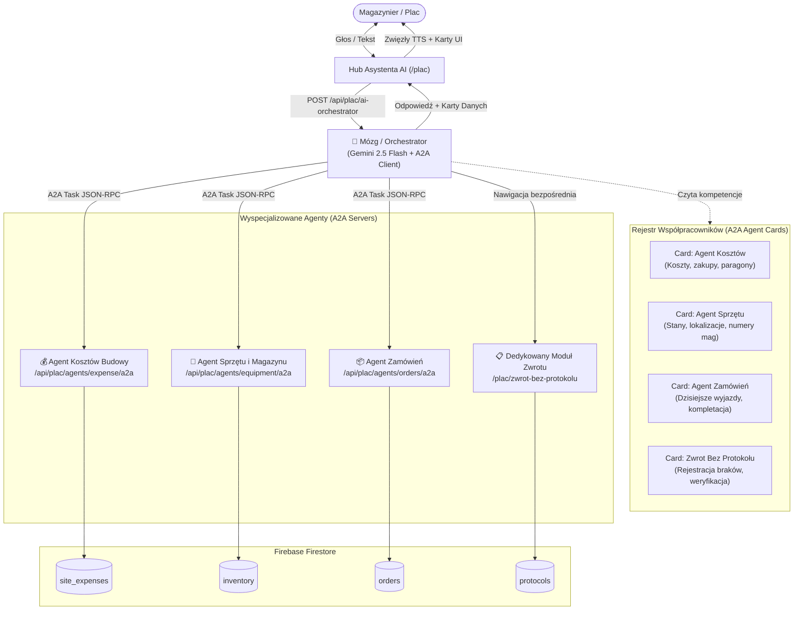

# 🚀 Plan Rozwoju: Multi-Agent A2A System & Globalny Głosowy Hub AI dla PESAM Plac

Plik planu: `dalszy_rozwoj.md`  
Status: **Zatwierdzony przez użytkownika / W trakcie realizacji**  
Środowisko: **Next.js 16 (App Router), React 19, Firebase Firestore, Vertex AI (`@google/genai` / `gemini-2.5-flash`), Google A2A Protocol (`@a2a-js/sdk`)**

---

## 1. Cel i Założenia

Użytkownik na placu budowy lub w magazynie operuje telefonem w trudnych warunkach roboczych (rękawice, hałas, pośpiech).
Dialog z asystentem musi być **lakoniczny, konkretny i zorientowany na zadania** — zero zbędnego small-talku ("Cześć, jestem asystentem...").

### Główne wytyczne:
1. **Styl komunikacji:** Komendy i konkretne pytania. Asystent zadaje jedno precyzyjne pytanie na raz (np. *"Podaj budowę"*, *"Jaki numer magazynowy wiertarki?"*).
2. **Bezpieczeństwo kodów autoryzacyjnych:** AI **nie zna** kodów zabezpieczających (np. kod bypassu e-mail dla zwrotów bez protokołu). AI pyta o kod na samym końcu po skompletowaniu danych, a poprawność jest walidowana w 100% po stronie backendu. Po 3 błędnych próbach powiadomienie do dyrekcji jest wysyłane automatycznie.
3. **Architektura Multi-Agent (Google A2A):**
   - **Mózg / Router (Orchestrator):** Widzi swój zespół agentów przez oficjalne **Agent Cards** (`/.well-known/agent-card.json`), wie jakie mają kompetencje i deleguje zadania.
   - **Wyspecjalizowani agenci:** Działają jako niezależne serwery A2A (JSON-RPC over HTTP).
4. **Nienaruszalność kafelków:** Wszystkie kafelki modułów operacyjnych na `/plac` (Resztki, Zamówienia Dzisiejsze, Wypisz protokół, Inwentaryzacja, Archiwum Tarnów, Zgłoś zwrot bez protokołu) pozostają w pełni sprawne pod hubem AI.

---

## 2. Architektura Multi-Agent A2A (Google Agent-to-Agent Protocol)

---

## 3. Specyfikacja Agentów w Rejestrze A2A

### 🧠 Orchestrator (Mózg / Router) — `/api/plac/ai-orchestrator`
- **Rola:** Analiza wejścia głosowego/tekstowego, dopasowanie intencji do zarejestrowanych kart agentów (`Agent Cards`).
- Jeśli zadanie wymaga doprecyzowania (np. brak kwoty lub budowy) — Mózg natychmiast zadaje jedno lakoniczne pytanie.
- Jeśli zadanie pasuje do agenta — Mózg deleguje task przez A2A JSON-RPC i zwraca zwięzłą odpowiedź oraz interaktywną kartę na ekran telefonu.

---

### 💰 Agent 1: Koszty Budowy (`expense-agent`)
- **Endpoint A2A:** `/api/plac/agents/expense/a2a`
- **Agent Card:** `/api/plac/agents/expense/agent-card`
- **Kompetencje:** Rejestracja wydatków budowy, zakupów, paliwa, napraw, paragonów.
- **Wymagane parametry:** `siteNameOrId`, `amount`, `title`, opcjonalnie `category`.
- **Kolekcja docelowa:** `site_expenses`
- **Zachowanie:**
  - *"Dopisz do kosztów budowy Tuchów 20 zł"* &rarr; Agent dopytuje: *"Na co poszła ta kwota?"*
  - Użytkownik: *"Paliwo do zagęszczarki"* &rarr; Agent zapisuje rekord i kwituje: *"Zapisano 20 zł na paliwo dla budowy Tuchów."*

---

### 🔧 Agent 2: Sprzęt i Magazyn (`equipment-agent`)
- **Endpoint A2A:** `/api/plac/agents/equipment/a2a`
- **Agent Card:** `/api/plac/agents/equipment/agent-card`
- **Kompetencje:** Sprawdzanie stanów narzędzi, lokalizacji, numerów magazynowych, alokacji między budowami.
- **Kolekcja docelowa:** `inventory` (pola `allocations`, `inventoryNumber`, `status`, `type`).
- **Zachowanie:**
  - *"Gdzie jest młotowiertarka nr 61?"* &rarr; Agent odpowiada: *"Młotowiertarka nr 61 znajduje się na budowie Tuchów, stan: sprawna."* + wyświetla kartę narzędzia.
  - *"Pokaż wolne zagęszczarki"* &rarr; Agent weryfikuje `allocations.MAGAZYN > 0` i zwraca listę dostępnych sztuk.

---

### 📦 Agent 3: Zamówienia i Wyjazdy (`orders-agent`)
- **Endpoint A2A:** `/api/plac/agents/orders/a2a`
- **Agent Card:** `/api/plac/agents/orders/agent-card`
- **Kompetencje:** Sprawdzanie dziennych zapotrzebowań, zamówień transportowych i kompletacji na placu.
- **Kolekcja docelowa:** `orders` (filtr `date == today`).
- **Zachowanie:**
  - *"Co dzisiaj jedzie na Tuchów?"* &rarr; Agent zwraca listę pozycji przygotowanych do załadunku dla kierowcy.

---

### 📋 Moduł 4: Zwrot Bez Protokołu (`return-no-protocol`)
- **Ścieżka:** `/plac/zwrot-bez-protokolu`
- **Specyfika:** Specjalistyczny, wielokrokowy asystent proceduralny z aparatem fotograficznym.
- **Wprowadzone poprawki:**
  - ❌ Brak powitań i zbędnego wstępu — asystent od razu pyta: *"Podaj nazwę budowy, z której przyjechał zwrot."*
  - 🔒 **Bezpieczeństwo kodu:** AI nie zna kodu zabezpieczającego. Pyta na samym końcu: *"Podaj kod zabezpieczający jeśli chcesz pominąć wysyłkę do dyrekcji. Albo zatwierdź bez kodu."*
  - 🛡️ Walidacja poprawności kodu po stronie serwera (`route.ts`).
  - ⚠️ Licznik prób: po 3 błędnych próbach zwrot zostaje zapisany, a alert e-mail trafia do dyrekcji.

---

## 4. Architektura UI na `/plac` (Mobile-First)

1. **Górna sekcja (Hub AI):**
   - Kompaktowy, nowoczesny panel z mikrofonem i pulsującym wskaźnikiem gotowości AI.
   - Szybkie polecenia (chips): *"💰 Dopisz 35 zł do budowy Tuchów"*, *"🔧 Gdzie jest wiertarka 14?"*, *"📦 Co dzisiaj jedzie na wyjazd?"*.
   - Po aktywacji głosu: zwięzła wymiana zdań, karty potwierdzeń (karta wydatku z opcją edycji, lista sprzętu).
2. **Dolna sekcja (Nienaruszone Menu Kafelkowe):**
   - 📦 Magazyn Resztek (`/plac/resztki`)
   - 📋 Zgłoś Zwrot Bez Protokołu (`/plac/zwrot-bez-protokolu`)
   - 🚚 Zamówienia Dzisiejsze (`/plac/zamowienia`)
   - ✍️ Wypisz Protokół (`/plac/protokol`)
   - 🔍 Inwentaryzacja (`/plac/inwentaryzacja`)
   - 🏛️ Archiwum Tarnów (`/plac/archiwum`)

---

## 5. Harmonogram Realizacji

| Etap | Zakres | Status |
|:---|:---|:---:|
| **Etap 1 (FIX)** | Poprawka asystenta zwrotu bez protokołu: usunięcie powitania, natychmiastowe pytanie o budowę, backendowa deterministyczna walidacja kodu, limit 3 prób, brak zapętleń przy decyzji "bez kodu", bezpośredni zapis. | ✅ **UKOŃCZONY** |
| **Etap 2 (A2A Registry)** | Utworzenie rejestru współpracowników (`src/lib/agents/registry.ts`) oraz modeli kart agentów (`Agent Cards`). Instalacja `@a2a-js/sdk`. | ✅ **UKOŃCZONY** |
| **Etap 3 (A2A Agents)** | Implementacja wyspecjalizowanych agentów A2A: Koszty Budowy (`expense`), Sprzęt (`equipment`), Zamówienia (`orders`). | ✅ **UKOŃCZONY** |
| **Etap 4 (Orchestrator)** | Endpoint `/api/plac/ai-orchestrator` — Mózg routujący zapytania przez klienta A2A do właściwych agentów. | ✅ **UKOŃCZONY** |
| **Etap 5 (Hub UI na /plac)** | Integracja UI na `/plac` (`PlacVoiceHub`) z mikrofonem, dynamicznymi kartami wyników i zachowaniem istniejących kafelków. | ✅ **UKOŃCZONY** |
| **Etap 6 (Weryfikacja)** | Testy scenariuszy mobilnych, walidacja kodu bypass (3 próby / bez kodu / poprawny kod), weryfikacja routingu A2A, build produkcyjny. | ✅ **UKOŃCZONY** |
