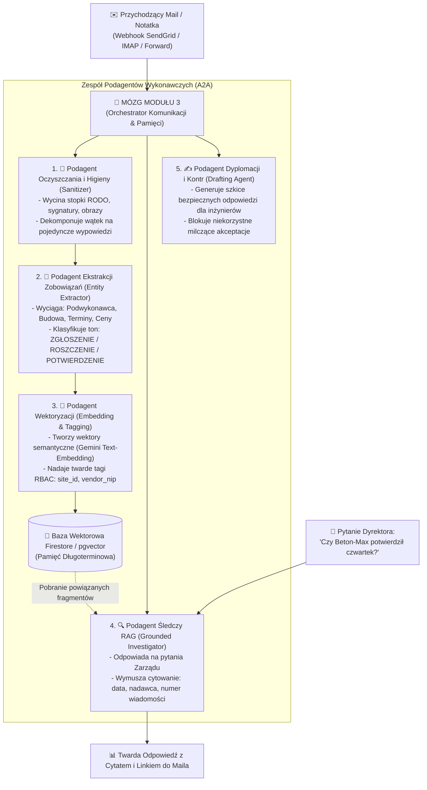
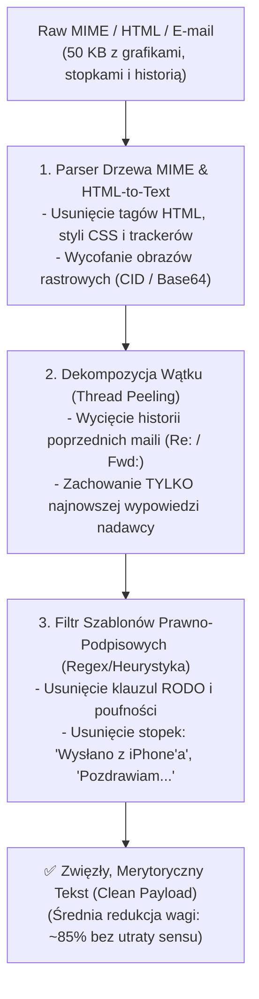
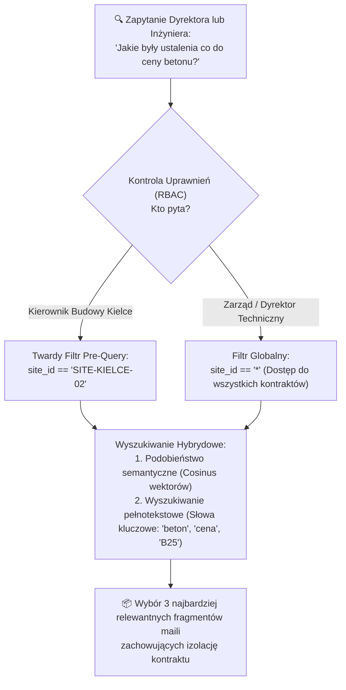
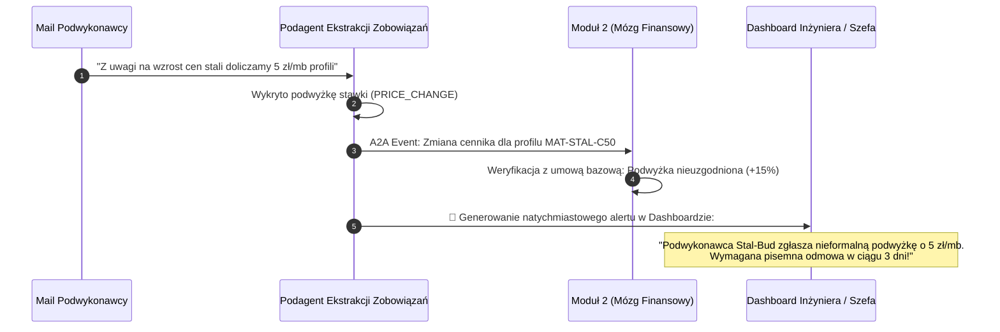
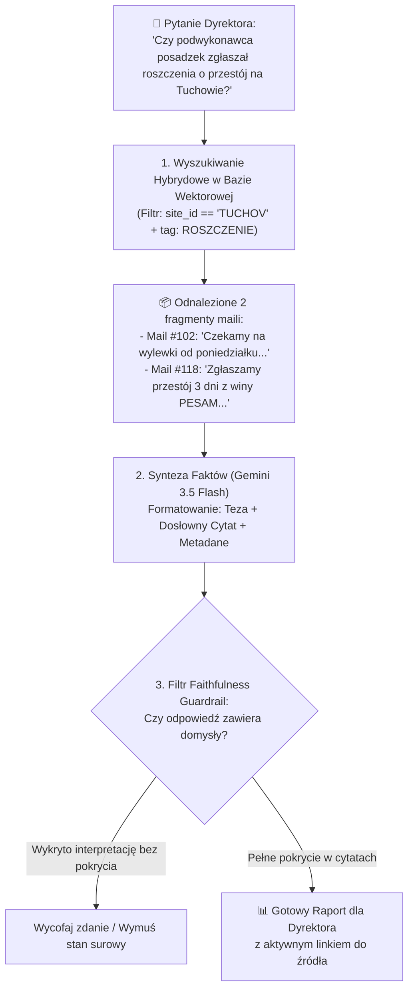
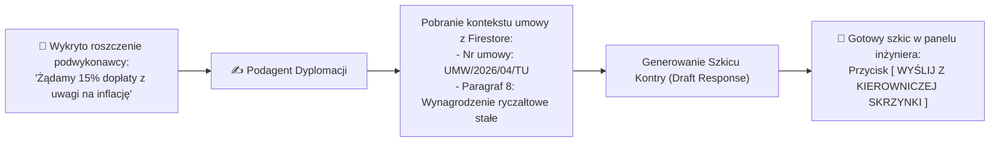

Podobnie jak przy Module 2, podzielmy **Moduł 3** na **3 logiczne części**:

* **Część 1/3:** Wyzwania biznesowe, cel, zasada Grounded Truth oraz Topologia Wieloagentowa (A2A).
* **Część 2/3:** Czyszczenie szumu mailowego, ekstrakcja zobowiązań (terminy/ceny) i hybrydowa baza wektorowa (RBAC per budowa).
* **Część 3/3:** Silnik zapytań Zarządu (Grounded RAG z cytowaniem), asystent dyplomatyczny (szkice odpowiedzi) i zunifikowany kontrakt danych.

Oto **Część 1/3**.

---

# 📐 DOKUMENTACJA ARCHITEKTONICZNA: MODUŁ 3 (CZĘŚĆ 1/3)
### Poczta Podwykonawców, Bramka Komunikacyjna i Grounded RAG (Pamięć Dyplomatyczna PESAM)

---

## 1. Wyzwania Biznesowe: Dlaczego firmy budowlane tracą miliony na sporach?

Na budowie komunikacja z podwykonawcami to pole minowe. W realiach polskiego rynku wykonawczego występują cztery krytyczne punkty zapalne:

1. **Efekt „Ustalaliśmy to na budowie” (Słowo przeciwko słowu):**  
   Podwykonawca schodzi z budowy lub żąda dopłaty 40 000 zł, twierdząc: *„przecież kierownik Janek zgodził się na to w zeszłym miesiącu”*. Janek już w firmie nie pracuje, a Zarząd nie ma jak zweryfikować prawdy.
2. **Prywatne skrzynki i rozproszone maile:**  
   Kierownicy kontraktów prowadzą korespondencję ze swoich imiennych skrzynek (`j.kowalski@pesam.pl`). Gdy pojawia się spór sądowy lub groźba kar umownych, odnalezienie kluczowego maila sprzed 6 miesięcy z załącznikiem PDF graniczy z cudem.
3. **Ciche zmiany terminów i cen:**  
   Podwykonawca w piątym akapicie maila rzuca mimochodem: *„wylewki zrobimy nie w ten czwartek, tylko za dwa tygodnie, a cena wzrośnie o 15 zł/m²”*. Jeśli inżynier tego w porę nie oprotestuje, w sądzie jest to traktowane jako milcząca akceptacja.
4. **Szum mailowy (Email Clutter):**  
   Wątki mają po 15 odpowiedzi, zawierają gigantyczne stopki prawne RODO, grafiki z podpisami, powielone cytowania i reklamy hurtowni. Modele LLM karmione takimi „śmieciami” gubią się i generują fałszywe wnioski.

---

## 2. Cel Biznesowy i Żelazna Reguła: Grounded Truth (Zero Halucynacji)

> **Misja Modułu 3:** Stworzenie centralnej, nieulotnej pamięci korespondencyjnej firmy PESAM, która indeksuje każdy mail, protokół i notatkę ze spotkania, umożliwiając Zarządowi natychmiastowe uzyskanie twardych dowodów.

### Żelazna Reguła Grounded RAG:
W Module 3 wprowadzamy rygorystyczny warunek odpowiedzi:
$$\text{Odpowiedź} = \text{Tylko i wyłącznie fakty poparte cytatem} \;+\; \mathbf{ID\;Wiadomości} \;+\; \mathbf{Data} \;+\; \mathbf{Autor}$$

Jeśli w bazie nie ma twardego potwierdzenia, agent ma **bezwzględny zakaz domyślania się**. Zamiast tego zwraca status: `BRAK_DANYCH_W_KORESPONDENCJI` wraz z listą przejrzanych wątków.

---

## 3. Bramka Wejściowa: Jak maile trafiają do systemu?

Nie zmuszamy inżynierów do zmiany narzędzi – kierownicy nadal używają Outlooka lub Gmaila. Ingestja odbywa się w trzech równoległych kanałach:

1. **Dedykowany adres centralny (`podwykonawcy@pesam.pl`):**  
   Oficjalny adres podawany w umowach budowlanych do korespondencji formalnej.
2. **Automatyczne UDW (BCC) dla Kierowników:**  
   Reguła w poczcie inżyniera: każdy mail wysyłany do podwykonawcy ma w niewidocznej kopii adres systemowy `inbound-rag@pesam.pl`.
3. **Przekazywanie wiadomości (Forward):**  
   Kierownik dostaje trudnego maila od podwykonawcy $\rightarrow$ przesyła go na adres bota $\rightarrow$ bot w 5 sekund analizuje wątek i zwraca kierownikowi sugerowaną, bezpieczną prawnie odpowiedź.

---

## 4. Architektura Wieloagentowa (A2A) Modułu 3

Modułem zarządza **Orkiestrator Pamięci i Komunikacji**, który kieruje pięcioma podagentami:



### Role i Zadania Podagentów:

* **Podagent Oczyszczania (`EmailSanitizerAgent`):**  
  Brama higieniczna. Zamienia 50-kilobajtowy, „zaśmiecony” mail w czysty, zwięzły tekst zawierający wyłącznie treść merytoryczną.
* **Podagent Ekstrakcji Zobowiązań (`CommitmentExtractor`):**  
  Czyta treść i szuka kluczowych słów budowlanych: *aneks, opóźnienie, gwarancja, cena, zł/m², wejście na budowę, odbiór*. Przypisuje maila do konkretnej budowy (`site_id`).
* **Podagent Wektoryzacji (`VectorTaggingAgent`):**  
  Zapisuje treść w przestrzeni wektorowej, ale **zawsze z metadanymi izolującymi** (aby kierownik budowy w Kielcach nie miał wglądu w korespondencję budowy w Tuchowie).
* **Podagent Śledczy RAG (`GroundedInvestigator`):**  
  Bierze pytanie dyrektora, przeszukuje bazę hybrydowo (słowa kluczowe + sens semantyczny) i składa odpowiedź wyłącznie z odnalezionych faktów.
* **Podagent Dyplomacji (`DiplomaticDraftingAgent`):**  
  Gdy podwykonawca zgłasza nieuzasadnione roszczenie, ten agent przygotowuje dla inżyniera projekt odpowiedzi powołujący się na zapisy umowy i wcześniejsze ustalenia.

---

*To jest koniec Części 1/3.*  
*Gdy będziesz gotowy, napisz **„część 2”**, a przejdziemy do szczegółów czyszczenia szumu mailowego, algorytmu ekstrakcji ustaleń oraz architektury hybrydowej bazy wektorowej (RBAC per budowa).*
# 📐 DOKUMENTACJA ARCHITEKTONICZNA: MODUŁ 3 (CZĘŚĆ 2/3)
### Higiena Szumu Mailowego, Ekstrakcja Zobowiązań i Hybrydowa Baza Wektorowa (RBAC)

---

## 1. Higiena i Oczyszczanie Szumu Mailowego (`EmailSanitizerAgent`)

Wiadomości e-mail w branży budowlanej to w 70% dane bezwartościowe: klauzule poufności RODO, stopki ze zdjęciami prezesów, animowane GIF-y, bannery hurtowni i wielopiętrowe cytowania (*„W dniu 14.10.2026 X napisał...”*).

Wpuszczenie takiego tekstu bezpośrednio do bazy wektorowej drastycznie pogarsza jakość wyszukiwania (tzw. zanieczyszczenie przestrzeni semantycznej).

### Rurociąg Oczyszczania (Sanitization Pipeline):



### Przykład Działania Sanitizera na Prawdziwym Mailu:

* **Przed oczyszczeniem (Surowy e-mail – 1800 słów ze stopkami i historią z 2 tygodni):**
  > *„Szanowni Państwo, w nawiązaniu do rozmowy... (...) Treść poufna zgodnie z RODO... (...) Sąd Rejonowy w Rzeszowie XII Wydział... (...) Wysłano z aplikacji Poczta dla systemu Windows... (...) [Historia 6 poprzednich wiadomości ze stopkami]”*
* **Po oczyszczeniu przez Sanitizera (Czysty komunikat – 35 słów):**
  > *„Nadawca: Tomasz Nowak (Beton-Max). Data: 2026-11-24. Treść: Potwierdzam dostawę betonu B25 na budowę w Tuchowie na czwartek 26.11 od godziny 8:00 rano. Cena zgodnie z aneksem: 340 zł/m³ netto. Pompa 28m w cenie.”*

---

## 2. Podagent Ekstrakcji Zobowiązań (`CommitmentExtractor`)

Ten podagent analizuje oczyszczony tekst i zamienia go na **twarde fakty biznesowe**. Działa na modelu `gemini-3.5-flash` ze strukturyzowanym schematem JSON (`responseSchema`).

### Zadania Ekstraktora:
1. **Identyfikacja Kontraktu (`site_id`):** Kojarzy nazwy potoczne (*„przychodnia”*, *„Tuchów szkoła”*, *„obwodnica”*) z oficjalnym ID projektu w PESAM.
2. **Kategoryzacja Intencji (Intent Classification):**
   * `POTWIERDZENIE_TERMINU` (np. potwierdzenie wejścia brygady na budowę).
   * `ROSZCZENIE_FINANSOWE` (np. żądanie zapłaty za prace dodatkowe).
   * `OSTRZEŻENIE_O_OPÓŹNIENIU` (np. brak frontu robót, zła pogoda).
   * `PROPOZYCJA_CENOWA` (np. nowa stawka za robociznę).
3. **Ekstrakcja Liczb i Dat (Entity Extraction):** Wyciąga kwoty, jednostki oraz twarde terminy kalendarzowe.

### Schemat JSON Wygenerowany przez Ekstraktora:

```typescript
// src/types/biuro/commitment.types.ts

export interface ExtractedCommitment {
  email_message_id: string;
  sender_email: string;
  sender_name: string;
  subcontractor_nip: string | null;  // Powiązanie z bazą dostawców
  target_site_id: string;            // np. "SITE-TUCHOV-01"
  intent_category: 'CONFIRMATION' | 'CLAIM' | 'DELAY_NOTICE' | 'PRICE_CHANGE' | 'GENERAL';
  urgency_level: 'LOW' | 'MEDIUM' | 'HIGH' | 'CRITICAL';

  // Wykryte zobowiązania merytoryczne
  commitments: Array<{
    type: 'DATE_AGREEMENT' | 'PRICE_AGREEMENT' | 'SCOPE_CHANGE';
    raw_statement: string;           // Dokładny cytat z maila
    normalized_value: string;        // np. "2026-11-26 08:00" lub "340.00 PLN / m3"
    financial_impact_pln: number | null;
  }>;

  // Analiza ryzyka prawnego dla firmy PESAM
  legal_risk_detected: boolean;
  legal_risk_summary: string | null; // np. "Próba narzucenia wyższej stawki bez formalnego aneksu"
}
```

---

## 3. Hybrydowa Baza Wektorowa z Izolacją Uprawnień (RBAC)

Maile nie mogą trafić do jednego wspólnego, niebezpiecznego worka. Jeśli inżynier z budowy w Kielcach zapyta system o podwykonawcę, nie może zobaczyć stawek i sporów z budowy w Tuchowie.

Rozwiązujemy to poprzez **Wyszukiwanie Hybrydowe z Twardym Filtrem Metadanych (Hybrid Search with Strict Pre-Filtering)**.



### Schemat Dokumentu Wektorowego w Bazie (`contractor_knowledge`):

```json
{
  "chunk_id": "CHK-20261124-MAIL-4492-01",
  "metadata": {
    "site_id": "SITE-TUCHOV-01",
    "subcontractor_nip": "8732804815",
    "subcontractor_name": "BETON-MAX SP. Z O.O.",
    "sender": "t.nowak@betonmax.pl",
    "message_date": "2026-11-24T08:14:00Z",
    "thread_subject": "Dostawa betonu czwartek Tuchów",
    "intent": "CONFIRMATION"
  },
  "content": {
    "clean_text": "Potwierdzam dostawę betonu B25 na budowę w Tuchowie na czwartek 26.11 od godziny 8:00 rano. Cena zgodnie z aneksem: 340 zł/m³ netto. Pompa 28m w cenie.",
    "verbatim_quote": "Cena zgodnie z aneksem: 340 zł/m³ netto."
  },
  // Wektor 768-wymiarowy wygenerowany przez Gemini Text-Embedding-004
  "embedding": [0.0142, -0.0481, 0.0892, 0.0031, "..."]
}
```

---

## 4. Wczesne Wykrywanie „Cichych Podwyżek” i Zmian Warunków

Gdy podagent wykryje kategorię `PRICE_CHANGE` lub `CLAIM`, nie czeka biernie na zapytanie użytkownika. 

W systemie zachodzi automatyczna **reakcja agentowa (A2A Event)**:



Dzięki temu firma PESAM zyskuje **tarczę prawną**: żaden mail z ukrytą podwyżką lub opóźnieniem nie przechodzi bez echa, a inżynierowie otrzymują sygnał do reakcji w tym samym dniu.

---

*To jest koniec Części 2/3.*  
*Gdy będziesz gotowy, napisz **„część 3”**, a przejdziemy do finalnych elementów Modułu 3: silnika zapytań Zarządu (Grounded RAG), asystenta tworzenia bezpiecznych pism/odpowiedzi oraz panelu UI.*
# 📐 DOKUMENTACJA ARCHITEKTONICZNA: MODUŁ 3 (CZĘŚĆ 3/3)
### Grounded RAG z Cytowaniem, Asystent Dyplomacji Prawnej i Kontrakt Wyjściowy

---

## 1. Silnik Odpowiedzi Zarządu: Grounded RAG (`GroundedInvestigator`)

Tradycyjne chatboty RAG mają tendencję do nadinterpretacji: gdy nie znajdują bezpośredniej odpowiedzi, zaczynają „wygładzać” rzeczywistość. W budownictwie, gdzie stawką są setki tysięcy złotych kar umownych, **odpowiedź bez twardego źródła jest bezużyteczna**.

Podagent Śledczy RAG (`GroundedInvestigator`) operuje w oparciu o **dwustopniowy filtr dowodowy**:
1. **Wyszukanie faktów (Retrieval):** Pobiera wyłącznie relewantne fragmenty maili po uwzględnieniu uprawnień (`site_id`).
2. **Weryfikacja prawdomówności (Faithfulness Guardrail):** Zanim odpowiedź trafi na ekran Dyrekcji, wewnętrzny walidator sprawdza, czy **każde wygenerowane zdanie ma pokrycie w dosłownym cytacie**.



---

### Przykład Odpowiedzi Generowanej dla Zarządu

> **Zapytanie Prezesa:**  
> *„Na jakiej podstawie hydraulik żąda dopłaty 12 000 zł na budowie w Kielcach?”*

> **Odpowiedź Podagenta Śledczego (Format Grounded RAG):**
>
> 📌 **STAN FAKTYCZNY:**  
> Podwykonawca **HYDRO-INSTAL Sp. z o.o.** zgłasza roszczenie o dopłatę w wysokości **12 000,00 zł netto** za montaż dodatkowych pionów kanalizacyjnych w szachtach B i C na I piętrze.  
>
> 📎 **DOWODY Z KORESPONDENCJI:**  
> 1. **Mail z dnia 12.11.2026 (godz. 14:22), nadawca: `p.wojcik@hydroinstal.pl` (Wątek #892):**  
>    *„W związku ze zmianą projektu branżowego z dnia 10.11 musieliśmy wykonać dwa dodatkowe piony fi 110 w szachcie B. Wyceniamy te prace zamienne na 12 tys. zł netto.”*  
> 2. **Odpowiedź Kierownika Budowy z dnia 13.11.2026 (godz. 08:10):**  
>    *„Przyjmuję do wiadomości konieczność wykonania prac, ale wycena musi zostać zweryfikowana przez nasz dział kosztorysów przed podpisaniem protokołu konieczności.”*  
>
> ⚖️ **STATUS PRAWNY:**  
> **BRAK PODSTAWY DO WYPŁATY.** Kierownik budowy nie zaakceptował kwoty (jedynie fakt wykonania robót). Do dziś nie wpłynął oficjalny Protokół Konieczności ani Aneks Finansowy.

---

## 2. Podagent Dyplomacji i Kontr (`DiplomaticDraftingAgent`)

W polskim prawie budowlanym brak natychmiastowej reakcji na pismo lub maila podwykonawcy bywa interpretowany jako milcząca zgoda na jego warunki.

Gdy Podagent Ekstrakcji wykryje roszczenie (`CLAIM`) lub nieuzgodnioną podwyżkę (`PRICE_CHANGE`), Podagent Dyplomacji natychmiast generuje dla inżyniera budowy **szkic profesjonalnej, bezpiecznej procesowo odpowiedzi**.



### Przykładowy Wygenerowany Szkic dla Inżyniera:
```text
Szanowny Panie Tomaszu,

W odpowiedzi na wiadomość z dnia 24.11.2026 dotyczącą waloryzacji wynagrodzenia o 15% na kontrakcie Tuchów, uprzejmie informuję, że zgodnie z § 8 ust. 2 Umowy nr UMW/2026/04/TU z dnia 15.04.2026, strony uzgodniły wynagrodzenie ryczałtowe stałe, które nie podlega zmianom w trakcie trwania etapu I.

Wykonawca nie przedstawił kalkulacji popartej twardymi wzrostami cen materiałów określonych w umowie. W związku z powyższym spółka PESAM nie znajduje podstaw do sporządzenia aneksu finansowego na wnioskowanych warunkach.

Deklarujemy gotowość do spotkania technicznego w najbliższy czwartek o godz. 11:00 na budowie celem omówienia bieżącego harmonogramu prac.

Z poważaniem,
[Imię i Nazwisko Kierownika Kontraktu]
Inżynier Budowy | PESAM Sp. z o.o.
```

---

## 3. Architektura Interfejsu `/dashboard/biuro/poczta`

Panel pocztowo-komunikacyjny zaprojektowano jako centrum dowodzenia prawnego i operacyjnego budowy:

```
+---------------------------------------------------------------------------------------------------------+
| 📬 CENTRUM KOMUNIKACJI I USTALEŃ BUDOWLANYCH (PESAM RAG)                     [ Filtr Budowy: Tuchów ▼ ]|
+---------------------------------------------------------------------------------------------------------+
| 🔍 ZADAJ PYTANIE O USTALENIA:                                                                           |
| [ Kiedy dekarze mieli zakończyć obróbki blacharskie na dachu?                                    ] [🔍] |
+---------------------------------------------------------------------------------------------------------+
| 📌 WYNIK WERYFIKACJI RAG (Pewność: 100% | Źródła: 2 maile):                                             |
| Termin ustalony w mailu z 14.11 to PIĄTEK 20.11.2026. Dekarze mają 4 dni opóźnienia.                    |
| 📎 Pokaż źródłowy wątek: #4412 (Dekarstwo Nowak)                                                        |
+---------------------------------------------------------------------------------------------------------+
| ⚠️ WYKRYTE RYZYKA I OCZEKUJĄCE REAKCJE (3):                                                             |
|                                                                                                         |
| 1. [NOWA PODWYŻKA] Stal-Bud żąda +5 zł/mb stali na Tuchowie.          [ PRZEJRZYJ SZKIC ODMOWY ]        |
| 2. [OSTRZEŻENIE] Beton-Max zgłasza brak frontu robót od środy.        [ WEZWIJ PODWYKONAWCĘ ROBÓT ZIEMNYCH ] |
| 3. [POTWIERDZENIE] Posadzki potwierdzone na 26.11 (godz. 08:00).       [ OK - ZAPISANO W HARMONOGRAMIE ] |
+---------------------------------------------------------------------------------------------------------+
```

---

## 4. Zunifikowany Kontrakt Danych Modułu 3 (Kompletny JSON Wyjściowy)

Poniższy obiekt reprezentuje pełny stan przetworzonego zdarzenia komunikacyjnego zapisanego w kolekcji `communications_archive`. Ten rekord jest bezpośrednim źródłem wiedzy dla **Modułu 4 (Autonomiczni Agenci ReAct)**:

```json
{
  "communication_id": "COMM-20261124-MAIL-4492",
  "metadata": {
    "source_channel": "INBOUND_EMAIL",
    "received_at": "2026-11-24T08:14:22Z",
    "processed_at": "2026-11-24T08:14:25Z",
    "processing_latency_ms": 310
  },
  "context": {
    "site_id": "SITE-TUCHOV-01",
    "site_name": "Tuchów Szkoła Podstawowa",
    "subcontractor": {
      "nip": "8732804815",
      "name": "BETON-MAX SP. Z O.O.",
      "sender_email": "t.nowak@betonmax.pl",
      "sender_display_name": "Tomasz Nowak"
    }
  },
  "extracted_facts": {
    "primary_intent": "CONFIRMATION",
    "urgency": "MEDIUM",
    "agreed_date": "2026-11-26T08:00:00Z",
    "agreed_price_net": 340.00,
    "unit": "m3",
    "material": "Beton towarowy B25 z pompą 28m",
    "summary": "Potwierdzenie dostawy betonu na czwartek rano w cenie 340 zł/m³."
  },
  "legal_and_risk_audit": {
    "has_financial_risk": false,
    "has_schedule_delay": false,
    "action_required": false,
    "generated_response_draft": null
  },
  "grounded_verification": {
    "verbatim_quote": "Potwierdzam dostawę betonu B25 na budowę w Tuchowie na czwartek 26.11 od godziny 8:00 rano. Cena zgodnie z aneksem: 340 zł/m³ netto.",
    "email_message_id_header": "<CAL-4492-betonmax@mail.betonmax.pl>",
    "vector_indexed": true,
    "confidence_score": 1.0
  }
}
```

---

## Podsumowanie Całości Modułu 3

Moduł 3 domyka obieg informacji w firmie PESAM:
1. **Oczyszcza szum:** Wycina stopki RODO i wielopiętrowe wątki, oszczędzając tokeny i wyostrzając analizę.
2. **Buduje pamięć dyplomatyczną:** Każdy mail jest przetłumaczony na twarde encje (kto, co, kiedy, za ile).
3. **Chroni przed sporami sądowymi:** Generuje twarde, cytowane odpowiedzi dla Dyrekcji i szkice natychmiastowych kontr na roszczenia podwykonawców.
4. **Zasila Moduł 4:** Wyjściowy JSON dostarcza kompletu informacji operacyjnych, dzięki czemu autonomiczni agenci ReAct mogą w piątki samodzielnie audytować stan budów.

Gotowe do przejścia do **Modułu 4: Agenci Autonomiczni, Pętla ReAct i Raporty Dyrektorskie**?