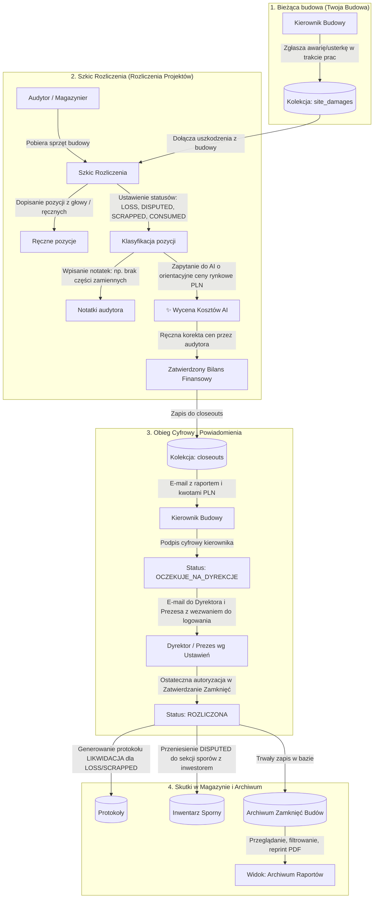

# Kompleksowy Plan Modułu Rozliczeń Budów (`rozliczanie.md`)

## 1. Opis Celu i Kontekst
Praktyka budowlana rodzi sytuacje nietypowe, których sztywny algorytm sprawdzania alokacji magazynowych nie jest w stanie obsłużyć:
1. **Sprzęt sporny / pozostawiony u inwestora** (np. ogrodzenie budowlane tymczasowe, które utknęło na placu z powodu sporu, braku możliwości odbioru lub oczekiwania na odkupienie/refakturowanie przez inwestora). Nie jest to ani kradzież/strata pracownika (`LOSS`), ani normalne zużycie (`CONSUMED`), ani nie powinno być bezpowrotnie likwidowane.
2. **Utylizacja / Złomowanie z braku możliwości naprawy** (np. uszkodzona łata do niwelatora, do której nie ma części zamiennych). Wymagana jest możliwość formalnego oznaczenia utylizacji z czytelną notatką audytora wyjaśniającą przyczynę.
3. **Finansowe podsumowanie strat dla Szefa i Zarządu z wyceną AI**: Szef oczekuje orientacyjnych kosztów finansowych w PLN dla każdej pozycji i podsumowania całego raportu. Model AI/LLM powinien automatycznie oszacować aktualne ceny rynkowe nowego lub używanego sprzętu, a audytor ma możliwość zatwierdzenia lub ręcznej edycji kwoty.
4. **Dopisywanie pozycji „z głowy” (ręcznych wpisów)**: Audytor musi mieć możliwość dopisania do protokołu zamknięcia rzeczy, których nie było w systemie lub zostały pominięte w papierowych WZ (np. zniszczony przewód siłowy, narzędzia podwykonawców, zaginiony osprzęt).
5. **Konfiguracja powiadomień Zarządu w Ustawieniach**: E-maile do Dyrektora i Prezesa z linkiem i wezwaniem do zalogowania się na konto w celu autoryzacji.
6. **Bieżące zgłaszanie uszkodzeń w trakcie budowy**: Moduł w *Twoja Budowa* rejestrujący awarie na bieżąco, które automatycznie zasilają raport końcowy.
7. **Archiwum i Trwała Historia**: Pełny wgląd w historyczne zamknięcia i protokoły.

---

## 2. Nowa Matryca Decyzyjna dla Pozycji w Raporcie

Zamiast dotychczasowych tylko dwóch opcji (`LOSS` / `CONSUMED`), audytor ma do dyspozycji 5 precyzyjnych statusów:

| Status Dyspozycji | Znaczenie biznesowe | Wpływ na stan magazynowy | Odpowiedzialność / Koszt |
| :--- | :--- | :--- | :--- |
| **❌ STRATA / BRAK** (`LOSS`) | Sprzęt zagubiony, skradziony, brak na stanie placu | Likwidacja z inwentarza (protokół LIKW) | Obciąża budowę / kierownika |
| **🧼 ZUŻYCIE NORMALNE** (`CONSUMED`) | Zużycie eksploatacyjne (tarcze, rękawice, drobny osprzęt BHP) | Zdjęcie ze stanu magazynu | Normalny koszt budowy |
| **🚧 POZOSTAWIONO / SPÓR Z INWESTOREM** (`DISPUTED_INVESTOR`) | Ogrodzenia, kontenery, szalunki zablokowane na budowie / do odkupu | Przeniesienie do lokacji: *SPORNE / U INWESTORA* (nie ulega skasowaniu!) | Potencjalne refakturowanie inwestora |
| **♻️ ZŁOMOWANIE / UTYLIZACJA** (`SCRAPPED`) | Sprzęt fizycznie obecny, ale nienaprawialny (np. brak części, połamany) | Zdjęcie ze stanu ze statusem *ZŁOMOWANE* | Koszt amortyzacji / spisanie ze stanu |
| **🗑️ WYKLUCZ / ANULUJ** (`EXCLUDED`) | Wyjaśniono, odnaleziono na magazynie, pomyłka w WZ | Brak zmian w alokacji (pozostaje do dyspozycji) | Brak obciążenia |

---

## 3. Szczegółowy Obieg Danych i Diagram Architektury



---

## 4. Szczegółowy Zakres Zmian w Poszczególnych Modułach

### A. Moduł Rozliczania Budów (`src/app/(dashboard)/dashboard/closeouts/page.tsx`)
1. **Dopisywanie pozycji „z głowy” (Wpisy ręczne do audytu):**
   - Przycisk **„➕ Dopisz pozycję z ręki”** otwierający czytelny formularz:
     - Nazwa przedmiotu (np. *„Ogrodzenie panelowe – uszkodzone przęsło”*, *„Przewód siłowy 50m”*),
     - Ilość i jednostka,
     - Wybór dyspozycji (`LOSS`, `DISPUTED_INVESTOR`, `SCRAPPED`, `CONSUMED`),
     - Szacunkowa cena jednostkowa PLN (z przyciskiem wyceny AI),
     - Notatka audytora (np. *„Pozostawione na prośbę inwestora”*).
2. **Obsługa sytuacji spornych (np. Ogrodzenie u Inwestora):**
   - Wybór opcji **„🚧 Pozostawiono u Inwestora / Sprawa sporna”**.
   - Pozycja nie obciąża kierownika jako kradzież, lecz tworzy w raporcie dedykowaną sekcję roszczeń wobec inwestora z łączną wycenioną kwotą.
3. **Obsługa złomowania/utylizacji (np. Łata do niwelatora):**
   - Wybór opcji **„♻️ Złomowanie / Do wyrzucenia”**.
   - Dedykowane pole na powód: np. *„Brak możliwości zakupu części zamiennych, wygięty profil – sprzęt niezdatny do eksploatacji”*.
4. **Moduł Wyceny Kosztów AI (Szacowanie wartości dla Szefa):**
   - Przycisk **„✨ Oszacuj koszty AI”** przy każdej pozycji oraz przycisk masowy **„✨ Oszacuj wszystkie braki AI”**.
   - Integracja z backendem AI (`/api/closeout-pricing`): na podstawie nazwy przedmiotu model podaje orientacyjną cenę rynkową PLN nowego/używanego sprzętu.
   - Każde pole ceny jest w pełni edytowalne przez użytkownika (input numeryczny PLN).
   - Dynamiczny licznik finansowy na dole raportu:
     - **Suma strat bezpośrednich (LOSS):** `XXXX zł`
     - **Wartość sprzętu u inwestora (DISPUTED):** `XXXX zł`
     - **Wartość złomowanego sprzętu (SCRAPPED):** `XXXX zł`
5. **Sekcja usuniętych/wykluczonych pozycji:**
   - Przycisk **„🗑️ Wyklucz”** przy każdej pozycji wraz z powodem (np. *„Odnaleziono na regale w magazynie centralnym”*). Możliwość cofnięcia.
6. **Nowa zakładka: „📜 Historia i Archiwum Zamknięć”:**
   - Pełna lista wszystkich zakończonych rozliczeń (`ROZLICZONA`).
   - Wyszukiwanie po nazwie budowy, dacie, kierowniku.
   - Podgląd całego raportu historycznego z kwotami, notatkami, sygnatariuszami podpisów i możliwością wydruku PDF.

---

### B. Nowe API Wyceny Kosztów AI (`src/app/api/closeout-pricing/route.ts`)
- Lekki endpoint wykorzystujący model LLM do zwracania orientacyjnych cen rynkowych w PLN na polskim rynku budowlanym dla przekazanych nazw narzędzi i materiałów (np. ogrodzenie budowlane, łata niwelacyjna, młot udarowy, cęgi).
- Zwraca propozycję ceny jednostkowej i krótkie uzasadnienie rynkowe.

---

### C. Rejestracja Uszkodzeń na Budowie (`src/app/(dashboard)/dashboard/my-site/page.tsx`)
- W panelu *Twoja Budowa* w kafelku **„Szkody / Straty”** oraz jako akcja w tabeli sprzętu:
  - Formularz **„➕ Zgłoś uszkodzenie sprzętu na budowie”**.
  - Zapis do kolekcji Firestore `site_damages`.
  - Dane te są automatycznie ładowane do audytu zamknięcia w zakładce *„💥 Uszkodzenia w trakcie projektu”*.

---

### D. Ustawienia Systemu (`src/app/(dashboard)/dashboard/admin/settings/page.tsx`)
- Nowe pola w sekcji zamykania budów:
  - **Adres e-mail Dyrektora ds. Realizacji** (z uprawnieniami do zatwierdzania),
  - **Adres e-mail Prezesa Zarządu**,
  - **Lista dodatkowych adresatów raportu finansowego** (np. dział księgowości/controllingu),
  - Przełącznik: Czy powiadomienie informacyjne ma wychodzić do Prezesa również w momencie zainicjowania szkicu przez magazyniera.

---

### E. Szablony Powiadomień E-mail (`src/app/api/closeout-email/route.ts`)
- Szablon e-mail zostaje wzbogacony o:
  - **Podsumowanie Finansowe dla Szefa:** Tabela z szacunkowymi kosztami strat i sprzętu u inwestora w PLN,
  - **Sekcję sprzętu spornego u inwestora** (z notatkami dotyczącymi ewentualnego rozliczenia z inwestorem),
  - **Sekcję złomowania/utylizacji** z uzasadnieniem audytora,
  - **Pozycje dopisane z ręki**,
  - **Wyraźne wezwanie Call-To-Action dla Dyrekcji i Prezesa:**
    > **Wymagane zatwierdzenie zamknięcia:**  
    > Prosimy o zalogowanie się na konto Dyrektora / Prezesa w systemie PESAM i autoryzację zamknięcia budowy w zakładce **Zatwierdzanie Zamknięć**.

---

### F. Moduł Zatwierdzania Zamknięć (`src/app/(dashboard)/dashboard/closeout-approvals/page.tsx`)
- Wyświetlanie pełnego raportu z podziałem na straty, sprzęt u inwestora, utylizację i pozycje ręczne wraz z wycenami PLN i notatkami.
- Dyrektor i Prezes widzą dokładną kwotę finansową bilansu zamknięcia budowy przed złożeniem podpisu cyfrowego.
- Zapewnienie, że po podpisaniu przez Dyrektora, sprzęt sporny u inwestora nie jest kasowany z bazy, lecz przenoszony do stanu roszczeń inwestorskich.

---

## 5. Struktura Nowych Modeli Danych (Firestore)

```typescript
// Element listy rozliczeniowej w closeouts/{siteId}
interface CloseoutDebtItem {
  id: string;
  name: string;
  type: string; // UNIQUE | BULK | MANUAL
  inventoryNumber: string;
  quantity: number;
  unit: string;
  resolution: "LOSS" | "CONSUMED" | "DISPUTED_INVESTOR" | "SCRAPPED";
  notes?: string; // np. "Brak części zamiennych, wygięta - do wyrzucenia" lub "Zostało u inwestora"
  estimatedUnitCost?: number; // Wycena jedn. w PLN (z AI lub ręczna)
  estimatedTotalCost?: number; // quantity * estimatedUnitCost
  isManualEntry?: boolean; // Czy dopisane "z głowy" podczas audytu
}

// Zgłoszenie uszkodzenia w trakcie trwania projektu (site_damages)
interface SiteDamage {
  id: string;
  siteId: string;
  siteName: string;
  inventoryId?: string;
  inventoryName: string;
  inventoryNumber?: string;
  quantity: number;
  unit: string;
  description: string;
  reportedByUid: string;
  reportedByName: string;
  reportedAt: string;
  status: "ZGŁOSZONE" | "W_ROZLICZENIU" | "WYJAŚNIONE";
}

// Dokument rozliczenia closeouts/{siteId}
interface CloseoutDocument {
  id: string;
  siteId: string;
  siteName: string;
  status: "OCZEKUJE_NA_KIEROWNIKA" | "OCZEKUJE_NA_DYREKCJE" | "ROZLICZONA";
  initiatedBy: string;
  initiatedByName: string;
  initiatedAt: string;
  managerUid?: string;
  managerName?: string;
  managerEmail?: string;
  managerSignedAt?: string;
  directorUid?: string;
  directorName?: string;
  directorSignedAt?: string;

  // Podsumowanie finansowe:
  financialSummary: {
    totalLossCost: number; // Suma strat w PLN
    totalDisputedCost: number; // Suma sprzętu u inwestora w PLN
    totalScrappedCost: number; // Suma złomowania w PLN
  };

  debtsList: CloseoutDebtItem[];
  excludedItems: Array<{ id: string; name: string; quantity: number; unit: string; reason: string; }>;
  siteDamagesList: SiteDamage[];
  claimsList: any[];
  detectiveList: any[];
  generalNotes?: string;
}
```

---

## 6. Plan Weryfikacji i Testów

1. **Test pozycji spornej (ogrodzenie u inwestora):**
   - Wybór ogrodzenia w zakładce Rusztowania -> zmiana statusu na `🚧 Pozostawiono u Inwestora / Spór`.
   - Wpisanie notatki o sporze z inwestorem. Sprawdzenie wyliczenia kwoty.
2. **Test pozycji utylizowanej (łata do niwelatora):**
   - Wybór łaty w Osprzęt -> zmiana statusu na `♻️ Złomowanie / Utylizacja`.
   - Wpisanie notatki: „Brak możliwości dokupienia części zamiennych, wygięta, do wyrzucenia”.
3. **Test pozycji dopisanej z głowy:**
   - Kliknięcie „➕ Dopisz pozycję z ręki”, wprowadzenie nazwy, ilości, notatki.
   - Weryfikacja, czy pozycja pojawia się na liście z oznaczeniem [Wpis ręczny].
4. **Test wyceny AI i ręcznej korekty cen:**
   - Kliknięcie „✨ Oszacuj koszty AI”. Weryfikacja pobrania orientacyjnych cen w PLN.
   - Zmiana ceny z palca (np. z 150 zł na 180 zł) – sprawdzenie przeliczenia sumy całego raportu.
5. **Test wysyłki powiadomień:**
   - Wysłanie raportu do podpisu kierownika, a po jego podpisaniu – wysyłka do Dyrektora i Prezesa ze wszystkimi kwotami PLN, notatkami i wezwaniem do logowania.
6. **Test Archiwum:**
   - Po ostatecznym zamknięciu budowy sprawdzenie, czy raport jest natychmiast dostępny w zakładce „📜 Historia i Archiwum Zamknięć”.
